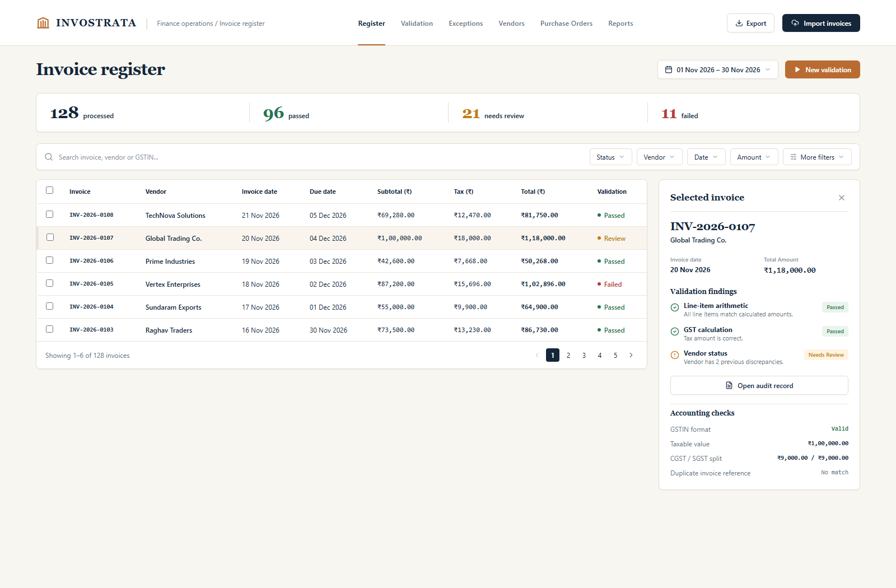
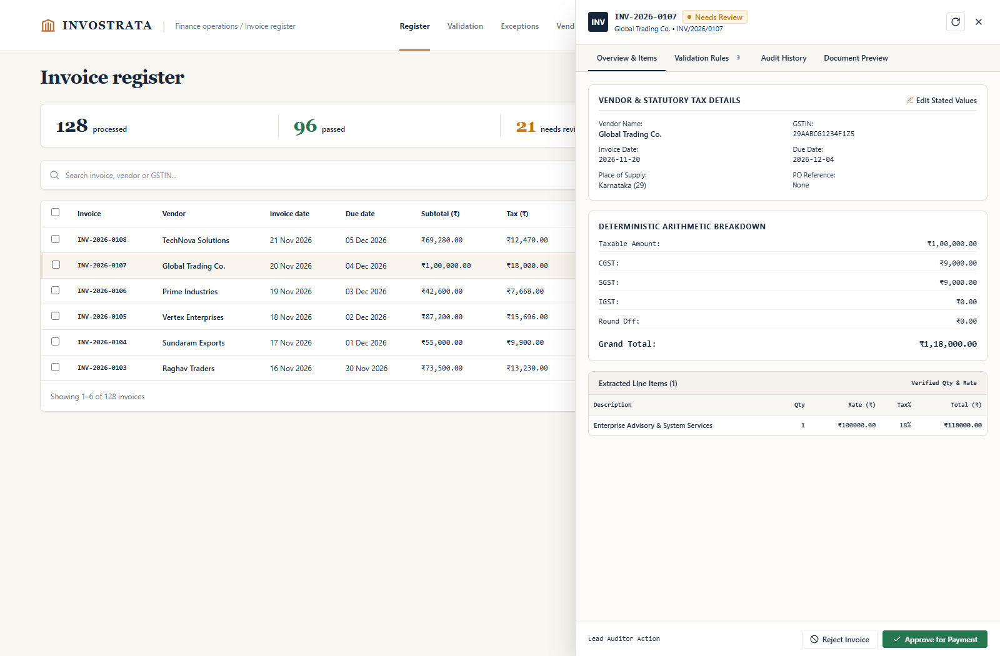
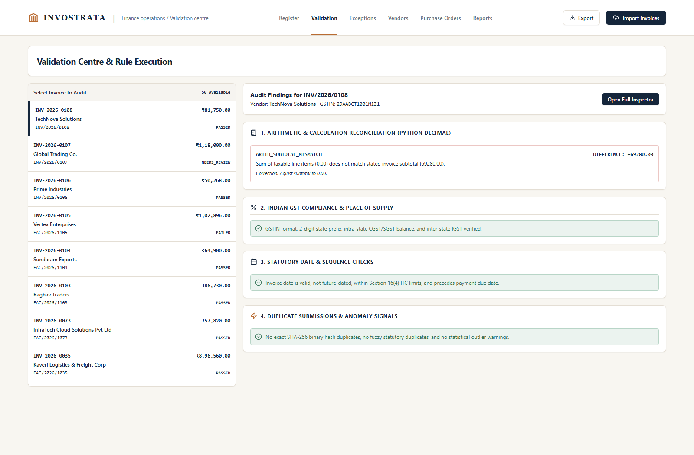
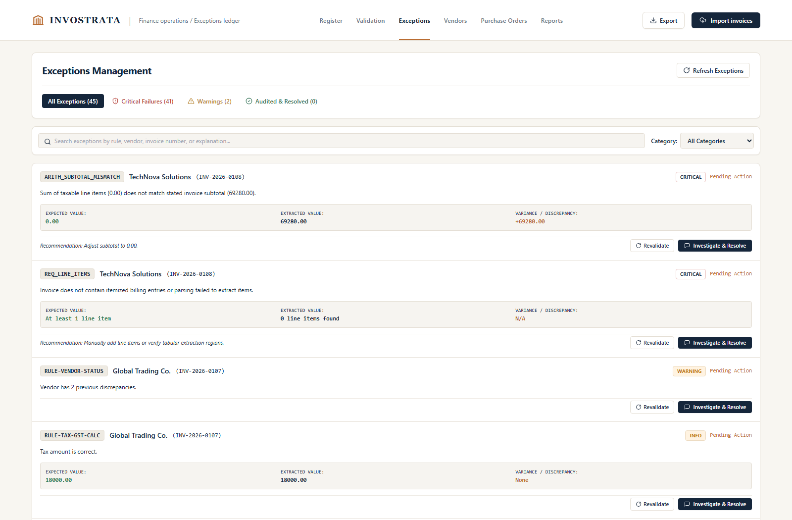

# INVOSTRATA — Automated Invoice Validation & Financial Consistency Workstation

> **Tagline:** Every invoice checked. Every discrepancy explained.  
> **Domain:** FinTech / Financial Automation / Document Intelligence / Accounting Operations  
> **Day 29 of 90 Days – 90 Projects Challenge**

---

## 1. Project Title & Overview
**INVOSTRATA** is an enterprise-grade automated invoice validation and financial consistency workstation designed for financial controllers, auditors, and accounts payable (AP) operations. It ingests multi-format invoices (PDF, image, CSV, Excel), parses deliverables, independently verifies line-item calculations using exact Python Decimal arithmetic, validates Indian GST compliance, detects duplicate submissions, investigates anomalies, and performs 3-way purchase order reconciliation.

---

## 2. Problem Statement & Motivation
Corporate accounting teams process hundreds of vendor invoices monthly. Manual verification results in:
- Silent arithmetic compounding errors.
- Costly statutory GST non-compliance (mismatched state codes, improper CGST/SGST/IGST division).
- Duplicate payments caused by near-identical or resubmitted invoices.
- Split-billing to circumvent procurement authorizations.
- Disconnect between contracted Purchase Orders (PO), delivered warehouse goods (GRN), and billed invoices.

INVOSTRATA eliminates these operational risks with a local-first, deterministic validation engine providing mathematical verification, audit trails, and explainable discrepancy diagnostics.

---

## 3. Objectives & Intended Users
- **Financial Controllers & AP Managers**: Reconcile invoices against approved POs and GRNs.
- **Tax Compliance Officers**: Verify statutory 15-character Indian GSTIN structures and state codes.
- **Auditors & Fraud Investigators**: Uncover duplicate submissions, unusual discounts, and statistical amount spikes.

---

## 4. Key Features
1. **Multi-Format Ingestion**: Drag-and-drop batch upload for PDF, PNG, JPG, CSV, Excel (`.xlsx`), and manual invoice entry.
2. **Deterministic Arithmetic Verification**: Exact `decimal.Decimal` calculations (`Qty × Price - Discount = Taxable`, Subtotal, GST, Round-Off, Grand Total).
3. **Indian GST Validation**: Validates 15-character GSTIN format, state code alignment, intra-state CGST/SGST equality, and inter-state IGST enforcement.
4. **Multi-Tiered Duplicate Detection**:
   - Exact SHA-256 binary document hash match.
   - Exact statutory field match (Vendor GSTIN + Invoice Number + Date + Amount).
   - Fuzzy/similar invoice detection (Levenshtein similarity, date proximity within 7 days, amount within 1%).
5. **Anomaly Investigation**: Identifies suspect round lump-sums, excessive commercial discounts (>20%), statistical outlier amounts, and frequent repeat submissions.
6. **Three-Way Matching**: Automated reconciliation comparing Purchase Orders, warehouse Goods Received Notes (GRN), and invoice line items.
7. **Interactive Inspection Panel**: 3-tab inspector (Overview, Validation Findings, Document Preview) with direct Approve, Reject, and Edit actions.
8. **Compliance Reporting**: One-click ReportLab PDF audit reports and Pandas CSV streaming exports.

---

## 5. 📸 Workstation Visuals & Platform Screenshots

### 1. Invoice Register & Selected Inspection Panel
*Primary accounting workstation featuring single 4-metric summary strip, search & filter toolbar, 9-column invoice register table, and docked right selected invoice inspection panel.*


### 2. Deep Audit Record & Reconciliation Inspector
*Slide-out inspector drawer providing complete line-item breakdown, deterministic arithmetic reconciliation, statutory tax verification, original PDF document preview, and controller approval actions.*


### 3. Validation Centre & Rule Execution Suite
*Automated audit suite evaluating invoices against deterministic Python Decimal arithmetic rules, statutory Indian GST constraints, chronological sequence checks, and duplicate collisions.*


### 4. Exceptions Ledger & Variance Triage Management
*Dedicated triage workspace for accounts payable teams to investigate failed invoices, review calculation differences, assign auditors, and log formal dispute notes.*


---

## 6. Visual Interface & Design System
INVOSTRATA features a professional financial operations interface inspired by modern accounting workstations and institutional audit platforms:
- **Page Background**: `#F8F6F1` (Warm Ivory / Off-White)
- **Main Surface**: `#FFFFFF` (Crisp White)
- **Secondary Surface**: `#F4F1EB` (Soft Stone)
- **Primary Text**: `#15263B` (Deep Navy)
- **Secondary Text**: `#687586` (Slate Grey)
- **Muted Text**: `#89919B` (Warm Muted Grey)
- **Primary Accent**: `#B96C32` (Muted Copper-Orange)
- **Secondary Accent**: `#244B60` (Refined Navy)
- **Success / Passed**: `#26764F` (Forest Green, bg: `#EAF4ED`)
- **Warning / Review**: `#C47B16` (Warm Amber, bg: `#FFF3E1`)
- **Critical / Failed**: `#B83D37` (Muted Crimson, bg: `#FBECEA`)
- **Borders**: `#E4DED4` (Warm Grey Border)
- **Table Dividers**: `#EAE5DC` (Soft Divider)

### Layout & Navigation Hierarchy
- **Horizontal Top Navigation**: Clean slim horizontal top bar with wordmark, workspace label, horizontal tabs, database connectivity status, quick Import Invoices action, and user profile.
- **No Permanent Left Sidebar**: Fully horizontal navigation freeing maximum horizontal width for dense accounting tables.
- **Financial Control Room**: Single horizontal summary strip (Total Processed, Pass Rate, Pending Review, Critical Failures, Duplicates) and dominant Invoice Processing Register data table with column sorting, live filters, multi-selection, and pagination.
- **Docked Audit Inspector**: Slide-out audit drawer with Overview, Validation Findings, Audit Trail, and Document Preview tabs + Approve, Reject, and Manual Correction controls.

---

## 7. Architecture & Data Flow

```
[ Upload Invoices (PDF / Image / CSV / Excel) ]
                        │
                        ▼
       [ SHA-256 Checksum & Parser ]
                        │
                        ▼
      [ Python Decimal Precision Engine ]
      ├── Arithmetic Reconciliation
      ├── Statutory Indian GST Rules
      ├── Date & Sequence Checks
      └── Vendor Consistency Checks
                        │
                        ▼
    [ Multi-Tier Duplicate & Anomaly Engine ]
    ├── Exact Hash & Statutory Field Matching
    └── Unsupervised Isolation Forest Anomaly Detection
                        │
                        ▼
    [ Three-Way Procurement Matching (PO <-> GRN <-> Invoice) ]
                        │
                        ▼
  [ FastAPI REST API <-> SQLite / PostgreSQL Database ]
                        │
                        ▼
     [ React 18 + TypeScript + Vite Workstation UI ]
```

---

## 8. Technology Stack
- **Frontend**: React 18, TypeScript, Vite, Tailwind CSS, Lucide Icons, Recharts
- **Backend**: Python 3.10+, FastAPI, Pydantic v2, SQLAlchemy 2.0, Alembic
- **Document Processing**: PyMuPDF (`fitz`), `pdfplumber`, Pillow
- **Mathematics & Data**: Python `Decimal`, Pandas, NumPy
- **Machine Learning**: Scikit-Learn (`IsolationForest`)
- **Reporting**: ReportLab (PDF), Pandas (CSV)
- **Database**: SQLite (local zero-config) / PostgreSQL (production ready)
- **Testing**: Pytest

---

## 9. Project Structure
```
90-days-90-projects-day-29-invostrata/
├── README.md
├── QUICKSTART.md
├── DEMO_SCRIPT.md
├── LICENSE
├── .gitignore
├── .env.example
├── requirements.txt
├── pyproject.toml
├── pytest.ini
├── setup.bat
├── run.bat
├── test.bat
├── app/
│   ├── main.py                     # FastAPI application & static mounts
│   ├── config.py                   # App settings & GST state mappings
│   ├── database.py                 # SQLAlchemy session management
│   ├── models/                     # Relational entities (Invoices, Vendors, POs)
│   ├── schemas/                    # Pydantic v2 schemas
│   ├── core/                       # Core validation, duplicate & anomaly engines
│   ├── routers/                    # FastAPI endpoints (Invoices, Reports, etc.)
│   └── seed/                       # Database seeder (105 synthetic invoices)
├── frontend/                       # React 18 + TypeScript + Vite workstation
│   ├── src/
│   │   ├── components/             # TopNav, SelectedInvoicePanel, InvoiceInspector
│   │   └── pages/                  # 10 dedicated operational workspaces
├── docs/                           # Architecture, User Guide & Screenshots
│   └── screenshots/                # 4 main platform feature screenshots
├── data/
│   ├── sample_invoices.csv         # Batch ingestion sample
│   └── README.md
└── tests/                          # 25 automated unit and integration tests
```

---

## 10. Prerequisites
- Windows 10/11
- Python 3.10+
- Node.js 18+ (for building frontend assets)

---

## 11. Step-by-Step Windows Installation

1. **Clone or Open the Repository**:
   ```cmd
   cd "D:\90 days\90-days-90-projects-day-29-invostrata"
   ```

2. **Automated Setup**:
   Execute the automated setup script:
   ```cmd
   setup.bat
   ```
   This will install Python dependencies, compile the React Vite bundle, and generate 105 synthetic invoices into `invostrata.db`.

---

## 12. Quick Start Commands
Launch the workstation:
```cmd
run.bat
```
Navigate to **`http://localhost:8000`** in your browser.

---

## 13. Environment Configuration
Copy `.env.example` to `.env`:
```ini
PROJECT_NAME="INVOSTRATA"
DATABASE_URL="sqlite:///./invostrata.db"
SECRET_KEY="invostrata_enterprise_financial_consistency_secret_2026"
ROUNDING_TOLERANCE=0.05
MAX_INVOICE_AGE_DAYS=180
HIGH_DISCOUNT_PERCENT=20.0
```

---

## 14. Dataset & Demonstration
The system includes 128 realistic synthetic invoices spanning 8 corporate vendors and 4 purchase orders. Scenarios include:
- Clean, fully reconciled invoices.
- Deliberate grand total and subtotal discrepancies.
- Erroneous inter-state and intra-state GST splits.
- Invalid 15-digit GSTIN structures.
- Future-dated and stale invoice records.
- Suspected exact and near duplicates.
- High commercial discounts (>20%).
- Real readable PDFs generated on disk in `storage/invoices/`.

---

## 15. Testing & Verification
Run the test suite:
```cmd
test.bat
```
Actual Test Results:
```
============================= 25 passed in 2.81s ==============================
```

---

## 16. Known Limitations
- OCR on poorly scanned low-resolution paper documents requires Tesseract installed on system PATH.
- Real-time Indian GST portal API lookups require authorized taxpayer portal credentials.

---

## 17. Security & Privacy
- Zero cloud or paid API dependencies.
- Local-first architecture; documents never leave the local environment.
- Safe filename sanitization prevents path traversal vulnerabilities.
- Protected document preview URLs.
- Sensitive files (`storage/`, `invostrata.db`, local raw screenshots) excluded via `.gitignore`.

---

## 18. License
MIT License. Developed for the 90 Days – 90 Projects Challenge.
