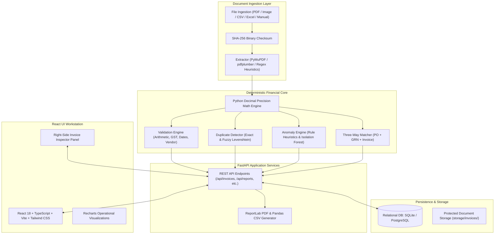

# VALICORA — System Architecture & Component Design

## Technical Architecture

## Technology Stack
- **Frontend**: React 18, TypeScript, Vite, Tailwind CSS, Lucide Icons, Recharts.
- **Backend**: Python 3.10+, FastAPI, Pydantic v2, SQLAlchemy 2.0, Alembic.
- **Data & Math**: Python `Decimal`, Pandas, NumPy.
- **Document Processing**: PyMuPDF (`fitz`), `pdfplumber`, Pillow.
- **ML / Anomaly**: Scikit-learn `IsolationForest`.
- **Reporting**: ReportLab (PDF), Pandas (CSV).
- **Testing**: Pytest.
